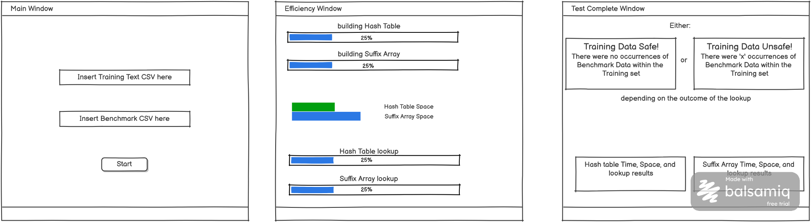

* **Team Name:** NaN of Your Business  
* **Team Members:** William O’Flaherty, Samuel Deegan, Laveena Bhuiyan  
* **Project Title:** Mise en Place  
  1. **Problem:** Accidental leakage of benchmark questions and answers into data sets that are used to train large language models.  
  2. **Motivation:** This leakage can result in the benchmark itself becoming futile, as it makes it impossible to tell whether the large language model has memorized the training data or has actually improved performance in the domain measured by the benchmark.  
  3. **Features**: One way to drastically decrease the likelihood of such leakage is by verifying that the content of the benchmark is not written verbatim in the training data.   
  4. **Data**:   
     * **Corpus:** We will use the AG News training set, which contains 120,000 rows (each consisting of a news title and a short description) provided as a CSV. This meets the 100,000-row project requirement and serves as our stand-in for an LLM training corpus.  
     * **Benchmark:** We will use the MMLU test questions. While these CSVs contain multiple-choice questions across 57 subjects, we will only extract and use the question text.  
     * **Planted Copies:** To test our structures, we will insert about 100 MMLU questions into random rows within the AG News corpus as known answers. We will ensure each planted question is at least 13 words long after cleanup so it can be successfully detected by our sliding window.  
  5. **Tools:** C++, SFML  
  6. **Visuals**: 
  7. **Strategy**: We will implement and compare two data structures, a hash table and a suffix array, to evaluate their efficiency in detecting exact benchmark contamination in training datasets. We will measure build time, lookup time, and memory usage. Our data will consist of the 120,000-document AG News corpus and MMLU benchmark questions, which will be read as plain text, lowercased, standardized to alphanumeric characters, and mapped to numeric IDs. To verify correctness, we will plant about 100 exact MMLU questions into the corpus as known answers. While both structures will be queried using each question's 13-word windows, their construction differs: the hash table is built from 13-word windows of the corpus, hashing each sequence from scratch and using linear probing for collision resolution in a flat array. The suffix array will sort every starting position in the corpus using a custom merge sort, comparing word-by-word until the words differ or a document ends, with lookups performed via binary search.  
  8. **Distribution of Responsibility and Roles:**   
     Will \- GUI and integrating data structures   
     Samuel \- Implementation of 1 of 2 algorithms  
     Lavenna \- Implementation of 1 of 2 algorithms  
* **References** 

  Used Claude Opus 5.5 to help develop ideas and scope the project. The conversation can be read [here.](https://claude.ai/share/b4435791-e7d9-4b43-bcd8-51c0c3bb49b6)
